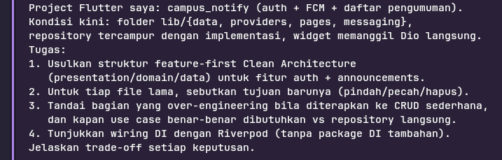
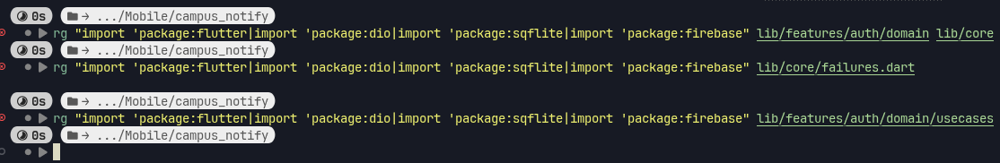
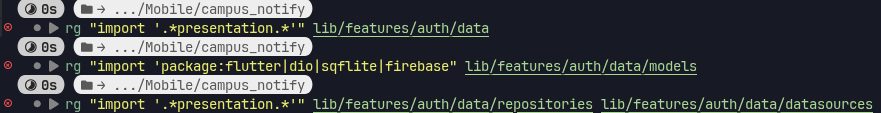
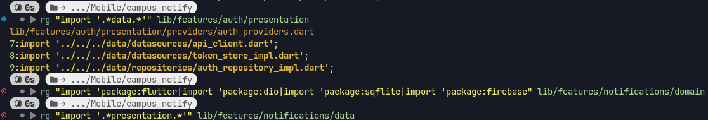
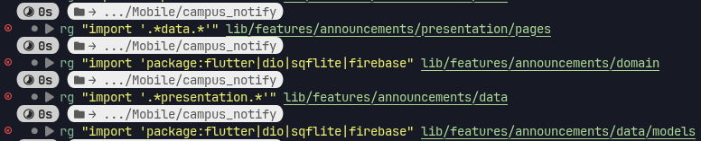
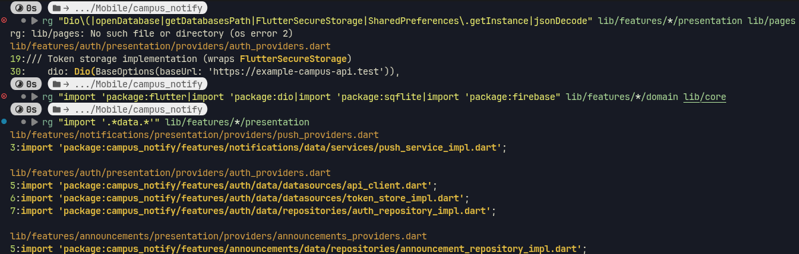
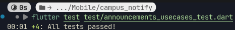

# Week 7

## Tujuan

- Menjelaskan prinsip SOLID dan separation of concerns dengan contoh kode Flutter
- Membedakan struktur feature-first vs layer-first beserta trade-off-nya
- Menjelaskan tiga layer (presentation, domain, data) dan aturan dependensi (dependensi mengarah ke dalam)
- Membedakan entity vs model serta peran repository, use case, dan dependency injection
- Merefactor project Minggu 5/6 menjadi struktur feature-first yang terpisah layer-nya
- Menguji use case dengan repository palsu tanpa database atau jaringan sungguhan

## Fitur Utama

- Fitur tetap sama seperti sebelumnya (campus notify), hanya "dibersihkan" strukturnya agar lebih rapi

## Hasil yang Dicapai

### Audit Layer 

| File Saat Ini | Layer Saat Ini | Target (Feature-first) | Status |
|---------------|----------------|------------------------|--------|
| `lib/main.dart` | `presentation` (composition root) | `lib/main.dart` (composition root) | OK |
| `lib/routes.dart` | `presentation` (routing config) | `lib/routes.dart` (shared) | OK |
| `lib/pages/login_page.dart` | `presentation` (UI) | `lib/features/auth/presentation/pages/login_page.dart` | Pindah folder |
| `lib/pages/home_page.dart` | `presentation` (UI) | `lib/features/home/presentation/pages/home_page.dart` | Pindah + perbaiki: panggil repo langsung |
| `lib/pages/announcement_page.dart` | `presentation` (UI) | `lib/features/announcements/presentation/pages/announcement_page.dart` | Pindah folder |
| `lib/providers/auth_provider.dart` | `presentation` (state + DI campur) | Dibelah dua:<br>• `lib/features/auth/data/datasources/` (api_client, token_store)<br>• `lib/features/auth/data/repositories/auth_repository_impl.dart`<br>• `lib/features/auth/presentation/providers/auth_providers.dart` (wiring + notifier) | Harus dibelah & pindah |
| `lib/data/auth_repository.dart` | `data` (impl + kontrak + DTO nyatu) | Dibelah tiga:<br>• `lib/features/auth/domain/entities/auth_session.dart` (entity murni)<br>• `lib/features/auth/domain/repositories/i_auth_repository.dart` (interface)<br>• `lib/features/auth/domain/usecases/*.dart` (login, refresh, postDeviceToken)<br>• `lib/features/auth/data/models/auth_session_dto.dart` (Model extends Entity + `toEntity()`)<br>• `lib/features/auth/data/repositories/auth_repository_impl.dart` (impl interface) | Harus dibelah & pindah |
| `lib/data/api_client.dart` | `data` (network config) | `lib/features/auth/data/datasources/api_client.dart` | Pindah folder |
| `lib/data/api_errors.dart` | `data` (error mapping) | `lib/core/failures.dart` (Failure hierarchy) + `NetworkFailure` | Ubah pola: exception → Failure record |
| `lib/data/token_store.dart` | `data` (secure storage impl) | Dibelah dua:<br>• `lib/features/auth/domain/repositories/i_token_store.dart` (interface)<br>• `lib/features/auth/data/datasources/token_store_impl.dart` (impl) | Harus bikin interface |
| `lib/messaging/push_service.dart` | `data` / `framework` (FCM wrapper) | Dibelah dua:<br>• `lib/features/notifications/domain/services/i_push_service.dart` (interface)<br>• `lib/features/notifications/data/services/push_service_impl.dart` (impl) | Harus bikin interface |
| `lib/firebase_options.dart` | `framework` (generated) | `lib/firebase_options.dart` (tetap root) |  OK |

### Tandai tiga pelanggaran klasik

#### Widget yang menyentuh jaringan / database langsung
```bash
rg "Dio\(|http\.|openDatabase|SharedPreferences\.getInstance|FlutterSecureStorage" lib/features/*/presentation lib/pages
```
Saat ini, `home_page.dart` baris 36 memanggil `authRepositoryProvider` (repository) langsung di widget.

#### Logika bisnis / formatting di dalam build()
```bash
rg "DateFormat|jsonDecode|\.toIso8601String" lib/features/*/presentation lib/pages
```
Saat ini, `AuthSession.fromJson` (parsing JSON) ada di `data/auth_repository.dart` yang dipanggil widget via repo. Harus dipindah ke Model DTO di `data/models/`.

#### Instansiasi manual (DI bocor)
```bash
rg "Repository\(|Dio\(BaseOptions" lib/features/*/presentation lib/pages lib/providers
```
Saat ini,
- `providers/auth_provider.dart` baris 23: `AuthRepository()` instansiasi manual
- `providers/auth_provider.dart` baris 18: `Dio(BaseOptions...)` di `buildApiClient`
- Semua wiring data-layer ada di `presentation/providers/`, harus pindah ke `data/` per fitur

### Dependency Rule (Feature-first)

```
┌─────────────────────────────────────────────────────────────┐
│                    presentation (per fitur)                 │  Widgets, Notifiers, UI Providers
└───────────────────────────────┬─────────────────────────────┘
                                │ depends on (use case / repository interface)
                                ▼
┌─────────────────────────────────────────────────────────────┐
│                      domain (per fitur)                     │  Entities, Repository Interfaces, Use Cases
│   ┌─────────────────────────────────────────────────────┐   │
│   │                  core/failures.dart                 │   │  Shared domain primitives
│   └─────────────────────────────────────────────────────┘   │
└───────────────────────────────┬─────────────────────────────┘
                                ▲ implements
                                │
┌───────────────────────────────┴─────────────────────────────┐
│                       data (per fitur)                      │  Repository Impl, Models (DTO), DataSources
└───────────────────────────────┬─────────────────────────────┘
                                │ uses
                                ▼
┌─────────────────────────────────────────────────────────────┐
│                           framework                         │  Dio, Firebase, FlutterSecureStorage, sqflite, GoRouter
└─────────────────────────────────────────────────────────────┘
```

## AI Challenge



Berikut hasil jawaban AI:

## 1. Struktur Feature-first yang Diusulkan

```
lib/
├── core/
│   └── failures.dart                 # Failure hierarchy (shared domain)
│
├── features/
│   ├── auth/                         # FITUR AUTENTIKASI
│   │   ├── domain/
│   │   │   ├── entities/
│   │   │   │   └── auth_session.dart
│   │   │   ├── repositories/
│   │   │   │   ├── i_auth_repository.dart
│   │   │   │   └── i_token_store.dart
│   │   │   └── usecases/
│   │   │       ├── login_usecase.dart
│   │   │       ├── refresh_token_usecase.dart
│   │   │       └── post_device_token_usecase.dart
│   │   ├── data/
│   │   │   ├── models/
│   │   │   │   └── auth_session_dto.dart
│   │   │   ├── repositories/
│   │   │   │   └── auth_repository_impl.dart
│   │   │   └── datasources/
│   │   │       ├── api_client.dart
│   │   │       └── token_store_impl.dart
│   │   └── presentation/
│   │       ├── providers/
│   │       │   └── auth_providers.dart    # SEMUA wiring + Notifier
│   │       └── pages/
│   │           └── login_page.dart
│   │
│   ├── announcements/                # FITUR PENGUMUMAN
│   │   ├── domain/
│   │   │   ├── entities/
│   │   │   │   └── announcement.dart
│   │   │   ├── repositories/
│   │   │   │   └── i_announcement_repository.dart
│   │   │   └── usecases/
│   │   │       ├── get_announcements_usecase.dart
│   │   │       └── get_announcement_detail_usecase.dart
│   │   ├── data/
│   │   │   ├── models/
│   │   │   │   └── announcement_dto.dart
│   │   │   ├── repositories/
│   │   │   │   └── announcement_repository_impl.dart
│   │   │   └── datasources/
│   │   │       └── api_client.dart          # Bisa share dengan auth via core/network
│   │   └── presentation/
│   │       ├── providers/
│   │       │   └── announcements_providers.dart
│   │       └── pages/
│   │           ├── announcement_list_page.dart
│   │           └── announcement_detail_page.dart
│   │
│   └── notifications/                # FITUR FCM/PUSH
│       ├── domain/
│       │   └── services/
│       │       └── i_push_service.dart
│       ├── data/
│       │   └── services/
│       │       └── push_service_impl.dart
│       └── presentation/
│           └── providers/
│               └── push_providers.dart
│
├── routes.dart                       # GoRouter (shared)
├── firebase_options.dart             # Generated (shared)
└── main.dart                         # Composition root
```

> **Catatan:** `home_page.dart` jadi `announcement_list_page.dart` di fitur `announcements`. `home` bukan fitur terpisah — cuma entry point setelah login.

---

## 2. Mapping File Lama → Tujuan Baru

| File Lama | Aksi | Tujuan Baru | Catatan |
|-----------|------|-------------|---------|
| `lib/main.dart` | **Pindah** | `lib/main.dart` | Tetap composition root, wiring semua feature providers |
| `lib/routes.dart` | **Pindah** | `lib/routes.dart` | Tetap shared, import page dari feature |
| `lib/firebase_options.dart` | **Tetap** | `lib/firebase_options.dart` | Generated, tidak diubah |
| `lib/pages/login_page.dart` | **Pindah** | `features/auth/presentation/pages/login_page.dart` | Sudah bersih, hanya ubah import |
| `lib/pages/home_page.dart` | **Pindah + Perbaiki** | `features/announcements/presentation/pages/announcement_list_page.dart` | **Hapus pemanggilan repo langsung**, pakai `announcementsProvider` |
| `lib/pages/announcement_page.dart` | **Pindah** | `features/announcements/presentation/pages/announcement_detail_page.dart` | Sudah bersih |
| `lib/providers/auth_provider.dart` | **PECAT (split & pindah)** | → 3 tujuan:<br>1. `features/auth/data/datasources/api_client.dart` (dari `buildApiClient`)<br>2. `features/auth/data/datasources/token_store_impl.dart` (dari `TokenStore`)<br>3. `features/auth/presentation/providers/auth_providers.dart` (wiring DI + `AuthNotifier`) | **File ini campur layer** — data providers pindah ke `data/`, notifier ke `presentation/providers/` |
| `lib/data/auth_repository.dart` | **PECAT (split 5 file)** | → 5 tujuan:<br>1. `features/auth/domain/entities/auth_session.dart` (Entity murni)<br>2. `features/auth/domain/repositories/i_auth_repository.dart` (Interface)<br>3. `features/auth/domain/repositories/i_token_store.dart` (Interface)<br>4. `features/auth/domain/usecases/*.dart` (3 use case)<br>5. `features/auth/data/models/auth_session_dto.dart` (Model + `fromJson` + `toEntity()`)<br>6. `features/auth/data/repositories/auth_repository_impl.dart` (Impl) | **Satu file = 6 tanggung jawab** — wajib dibelah |
| `lib/data/api_client.dart` | **Pindah** | `features/auth/data/datasources/api_client.dart` | Sudah bagus, tinggal pindah folder |
| `lib/data/api_errors.dart` | **UBAH POLA + Pindah** | `lib/core/failures.dart` | **Exception → Failure hierarchy + Record return** |
| `lib/data/token_store.dart` | **PECAT (split 2 file)** | → 2 tujuan:<br>1. `features/auth/domain/repositories/i_token_store.dart` (Interface)<br>2. `features/auth/data/datasources/token_store_impl.dart` (Impl wrap `FlutterSecureStorage`) | **Butuh interface di domain** |
| `lib/messaging/push_service.dart` | **PECAT (split 2 file)** | → 2 tujuan:<br>1. `features/notifications/domain/services/i_push_service.dart` (Interface)<br>2. `features/notifications/data/services/push_service_impl.dart` (Impl Firebase) | **Framework bocor ke presentation** — wajib di-wrap interface |

---

## 3. Over-Engineering vs Kapan Use Case Dibutuhkan

### ❌ Over-Engineering untuk CRUD Sederhana

| Pola | Kenapa Over-Engineering | Alternatif Ringan |
|------|------------------------|-------------------|
| **Use Case class untuk setiap CRUD** (Create, Read, Update, Delete masing-masing file) | Boilerplate berlebih untuk `fetchNotes()` yang cuma `return repo.fetchNotes()` | **Repository → Notifier langsung** untuk CRUD 1 entitas, 1 source, tanpa validasi bisnis |
| **Entity + Model + DTO terpisah total** (3 file per entitas) | `Model extends Entity` + `toEntity()` sudah cukup; DTO terpisah hanya butuh kalau shape API beda drastis dari domain | `Model extends Entity` di `data/models/` — **satu file** |
| **Interface untuk setiap repository** kalau cuma 1 implementasi & tidak di-test mock | Interface berguna untuk: multiple impl (prod/fake), contract testing, team terpisah. Kalau solo & 1 impl, `abstract class` di domain masih bagus tapi boleh di-skip | **Tetap buat interface** (harga murah, manfaat besar untuk test & swap) |
| **Failure record untuk operasi yang tidak mungkin gagal** (mis. `logout()` local only) | `logout()` cuma `await store.clear()` — tidak butuh `Failure` | `Future<void>` biasa, atau `Either<Failure, void>` kalau konsisten |

### ✅ Kapan Use Case **BENAR-BENAR** Dibutuhkan

| Kondisi | Contoh di `campus_notify` |
|---------|---------------------------|
| **Orkestrasi >1 repository** | `LoginUseCase`: `AuthRepository.login()` + `TokenStore.save()` + `PushService.postDeviceToken()` |
| **Validasi bisnis / aturan domain** | `PostDeviceTokenUseCase`: cek token valid, retry logic, deduplikasi |
| **Transformasi data kompleks** | `GetAnnouncementsUseCase`: merge data lokal + remote, sort, filter, pagination |
| **Transaksi / rollback** | Sync offline-first: write local → queue sync → mark dirty |
| **Reusability di multiple notifier** | `RefreshTokenUseCase` dipakai `AuthNotifier` + `ApiClient interceptor` + `BackgroundSync` |

### 🎯 Keputusan Praktis untuk Project Ini

| Operasi | Pakai Use Case? | Alasan |
|---------|-----------------|--------|
| `login` | ✅ **Ya** | 3 langkah: API login + save token + post FCM token |
| `refreshToken` | ✅ **Ya** | Dipakai 2 tempat: `AuthNotifier` + `ApiClient interceptor` (shared logic) |
| `postDeviceToken` | ✅ **Ya** | Bisa dipanggil dari `AuthNotifier` (login) + `PushService` (token refresh) |
| `getAnnouncements` | ❌ **Tidak** | CRUD sederhana: 1 repo, 1 source, tanpa validasi → `AnnouncementsNotifier` panggil `IAnnouncementRepository` langsung |
| `getAnnouncementDetail` | ❌ **Tidak** | Sama di atas |
| `logout` | ❌ **Tidak** | Local only, 1 line: `tokenStore.clear()` |

> **Rule of thumb:** *"CRUD satu-baris boleh langsung repository → notifier; use case menjadi wajib saat logika tumbuh."*

---

## 4. Wiring DI dengan Riverpod (Tanpa Package Tambahan)

### `features/auth/presentation/providers/auth_providers.dart`

```dart
import 'package:flutter_riverpod/flutter_riverpod.dart';
import 'package:dio/dio.dart';

import '../../../data/datasources/api_client.dart';
import '../../../data/datasources/token_store_impl.dart';
import '../../../data/repositories/auth_repository_impl.dart';
import '../../../domain/repositories/i_auth_repository.dart';
import '../../../domain/repositories/i_token_store.dart';
import '../../../domain/usecases/login_usecase.dart';
import '../../../domain/usecases/refresh_token_usecase.dart';
import '../../../domain/usecases/post_device_token_usecase.dart';

// ==========================================
// DATA LAYER PROVIDERS (Implementation)
// ==========================================

/// Token storage implementation (wraps FlutterSecureStorage)
final tokenStoreProvider = Provider<ITokenStore>((ref) {
  return TokenStoreImpl();
});

/// HTTP Client dengan interceptor auth & auto-refresh
final apiClientProvider = Provider<Dio>((ref) {
  final store = ref.watch(tokenStoreProvider);
  // Gunakan repository khusus untuk refresh (hindari circular dep)
  final refreshAuthRepo = AuthRepositoryImpl(
    dio: Dio(BaseOptions(baseUrl: 'https://example-campus-api.test')),
    tokenStore: store,
  );
  return buildApiClient(store, refreshAuthRepo);
});

/// Repository implementation (implements IAuthRepository)
final authRepositoryProvider = Provider<IAuthRepository>((ref) {
  return AuthRepositoryImpl(
    dio: ref.watch(apiClientProvider),
    tokenStore: ref.watch(tokenStoreProvider),
  );
});

// ==========================================
// DOMAIN LAYER PROVIDERS (Use Cases)
// ==========================================

final loginUseCaseProvider = Provider<LoginUseCase>((ref) {
  return LoginUseCase(ref.watch(authRepositoryProvider));
});

final refreshTokenUseCaseProvider = Provider<RefreshTokenUseCase>((ref) {
  return RefreshTokenUseCase(ref.watch(authRepositoryProvider));
});

final postDeviceTokenUseCaseProvider = Provider<PostDeviceTokenUseCase>((ref) {
  return PostDeviceTokenUseCase(ref.watch(authRepositoryProvider));
});

// ==========================================
// PRESENTATION LAYER (State Holder)
// ==========================================

final authStateProvider = AsyncNotifierProvider<AuthNotifier, bool>(
  AuthNotifier.new,
);

class AuthNotifier extends AsyncNotifier<bool> {
  @override
  Future<bool> build() async {
    final token = await ref.watch(tokenStoreProvider).readAccess();
    return token != null;
  }

  Future<void> login(String email, String password) async {
    state = const AsyncLoading();
    final result = await ref.watch(loginUseCaseProvider)(
      email: email,
      password: password,
    );
    if (result.failure != null) {
      state = AsyncError(result.failure!.message, StackTrace.current);
    } else {
      state = AsyncData(true);
    }
  }

  Future<void> logout() async {
    await ref.watch(tokenStoreProvider).clear();
    ref.invalidateSelf();
  }
}
```

### `features/announcements/presentation/providers/announcements_providers.dart`

```dart
import 'package:flutter_riverpod/flutter_riverpod.dart';

import '../../../data/repositories/announcement_repository_impl.dart'
import '../../../domain/repositories/i_announcement_repository.dart';

// Data layer
final announcementRepositoryProvider = Provider<IAnnouncementRepository>((ref) {
  return AnnouncementRepositoryImpl(
    dio: ref.watch(apiClientProvider), // Share Dio dari auth atau buat provider terpisah
  );
});

// Presentation layer: FutureProvider untuk list (simple CRUD → langsung repo)
final announcementsProvider = FutureProvider<List<Announcement>>((ref) async {
  final repo = ref.watch(announcementRepositoryProvider);
  final result = await repo.fetchAnnouncements();
  if (result.failure != null) throw Exception(result.failure!.message);
  return result.announcements;
});

// Detail page: pakai family provider atau FutureProvider.autoDispose
final announcementDetailProvider = FutureProvider.family<Announcement, String>((ref, id) async {
  final repo = ref.watch(announcementRepositoryProvider);
  final result = await repo.fetchAnnouncementDetail(id);
  if (result.failure != null) throw Exception(result.failure!.message);
  return result.announcement!;
});
```

### `features/notifications/presentation/providers/push_providers.dart`

```dart
import 'package:flutter_riverpod/flutter_riverpod.dart';

import '../../../data/services/push_service_impl.dart';
import '../../../domain/services/i_push_service.dart';

final pushServiceProvider = Provider<IPushService>((ref) {
  return PushServiceImpl();
});

// Notifier untuk handle token lifecycle kalau perlu
final pushTokenProvider = FutureProvider<String?>((ref) async {
  final service = ref.watch(pushServiceProvider);
  return service.getToken();
});
```

### `main.dart` (Composition Root)

```dart
void main() async {
  WidgetsFlutterBinding.ensureInitialized();
  await Firebase.initializeApp(options: DefaultFirebaseOptions.currentPlatform);

  // Register background handler (framework level)
  registerBackgroundHandler();
  await requestNotificationPermission();

  runApp(const ProviderScope(child: MyApp()));
}

class MyApp extends ConsumerStatefulWidget {
  const MyApp({super.key});
  @override
  ConsumerState<MyApp> createState() => _MyAppState();
}

class _MyAppState extends ConsumerState<MyApp> {
  @override
  void initState() {
    super.initState();
    WidgetsBinding.instance.addPostFrameCallback((_) async {
      // Init FCM via IPushService (bukan concrete class)
      final pushService = ref.read(pushServiceProvider);
      await pushService.initialize(
        onToken: (token) => ref.read(authRepositoryProvider).postDeviceToken(token),
        onMessage: (route) => ref.read(routerProvider).push(route),
      );
    });
  }

  @override
  Widget build(BuildContext context) {
    final router = ref.watch(routerProvider);
    return MaterialApp.router(
      routerConfig: router,
      theme: ThemeData(useMaterial3: true, colorSchemeSeed: Colors.indigo),
    );
  }
}
```

> **Kunci:** `ref.read/watch` **hanya di presentation layer**. Domain & Data **tidak import Riverpod**.

---

## 5. Trade-off Setiap Keputusan

| Keputusan | Trade-off (Pros/Cons) | Alasan Dipilih |
|-----------|----------------------|----------------|
| **Feature-first folder** | ✅ Scalable, tim paralel, modular<br>❌ Duplicate boilerplate per fitur | Best practice Flutter skala menengah+ |
| **Interface di domain (`IAuthRepository`)** | ✅ Testable (mock), swappable impl, kontrak eksplisit<br>❌ 1 file tambah per repo | Harga murah, manfaat besar|
| **Model extends Entity + `toEntity()`** | ✅ Single source of truth, mapping terpusat di data<br>❌ Entity ikut expose field yang mungkin tidak dipakai domain | Lebih pragmatis dari DTO terpisah total |
| **Record return `({T data, Failure? failure})`** | ✅ Exhaustive handling, no exception leak, type-safe<br>❌ Verbose di call site (`if (r.failure != null) ...`) | Alternatif: `Either<Failure, T>` (fpdart) — sama aja. |
| **Use Case hanya untuk operasi kompleks** | ✅ Hindari boilerplate CRUD sederhana<br>❌ Inconsistency: ada use case, ada tidak | **Pragmatis**. CRUD satu-baris boleh langsung repository → notifier" |
| **Riverpod sebagai DI container** | ✅ Zero package, compile-safe, scoped, testable (`ProviderContainer`)<br>❌ Learning curve, `ref` hanya di widget/notifier | Sudah dipakai project, fitur DI-nya kuat (`Provider`, `FutureProvider`, `NotifierProvider`) |
| **Shared `apiClientProvider` di auth, dipakai announcements** | ✅ Single Dio instance, shared interceptor auth<br>❌ Coupling antar fitur via `ref.watch(apiClientProvider)` | **Acceptable** — `Dio` adalah infrastructure, bukan domain. Bisa dipindah ke `core/network/` kalau mau purist. |
| **FCM di `notifications` feature, dipakai `auth` via interface** | ✅ Decoupled, testable, single responsibility<br>❌ Slight indirection untuk `postDeviceToken` | **Benar** — `auth` tidak boleh tahu Firebase. `IPushService` di domain. |

---

### Apakah interface repository tinggal di domain dan implementasi di data? (tolak bila AI menaruh keduanya di satu folder).

Tidak ada implementasi di domain, tidak ada interface di data

```
features/auth/domain/repositories/i_auth_repository.dart  # Interface
features/auth/data/repositories/auth_repository_impl.dart # Impl
```

### Apakah domain bebas import Flutter/Dio/SQLite/Firebase? Periksa dengan grep, bukan dengan membaca sekilas.

File domain hanya import `core/failures.dart` dan file domain lain. Verifikasi:

```bash
rg "import 'package:flutter|import 'package:dio|import 'package:sqflite|import 'package:firebase" lib/features/*/domain lib/core
```

### Apakah AI membuat use case untuk tiap CRUD satu-baris? (itu over-engineering: cukup repository langsung ke notifier, dengan alasan tertulis).

Tidak:
- `getAnnouncements`, `getAnnouncementDetail`, `logout` → **langsung Repository → Notifier**
- Hanya `login`, `refreshToken`, `postDeviceToken` pakai Use Case (alasan tertulis di atas)

### Apakah entity bebas mapping (toMap/fromMap/toJson hanya di model)?

Ya:
```dart
// domain/entities/auth_session.dart — tidak ada mapping
class AuthSession { final String access, refresh; }

// data/models/auth_session_dto.dart — semua mapping di sini
class AuthSessionDto extends AuthSession {
  factory AuthSessionDto.fromJson(Map<String, dynamic> json) { ... }
  AuthSession toEntity() => AuthSession(access: access, refresh: refresh);
}
```

### Apakah wiring DI terpusat di provider dan widget tidak new Repository() sendiri?

Ya:
```dart
// Provider file (tempat wiring)
final authRepositoryProvider = Provider<IAuthRepository>((ref) {
  return AuthRepositoryImpl(dio: ref.watch(apiClientProvider), ...);
});

// Widget (hanya konsumsi state)
class LoginPage extends ConsumerWidget {
  Widget build(BuildContext context, WidgetRef ref) {
    final state = ref.watch(authStateProvider); // Hanya baca state
    // TIDAK ADA: ref.read(authRepositoryProvider), new AuthRepository()
  }
}
```

### Keputusan final dan alasan teknis Anda, boleh berbeda dari saran AI selama berargumen.

Setuju dari AI karena sesuai dengan ceklis tugas

## Langkah Clean Architecture

### 1. Core & Auth Domain
Fondasi error handling + Auth domain (entity, interface, use case). membuat domain layer murni, bebas framework, kontrak repository & use case siap.

- Core Failures — `lib/core/failures.dart`: hierarki Failure untuk error handling domain. Digunakan sebagai kanal error lintas layer (data → domain → presentation)
-  Auth Domain Entity — `lib/features/auth/domain/entities/auth_session.dart`: entity AuthSession murni berisi accessToken & refreshToken. Tidak ada parsing JSON, mapping, atau import Flutter/Dio
- Auth Domain Repository Interfaces — `lib/features/auth/domain/repositories/i_auth_repository.dart` `lib/features/auth/domain/repositories/i_token_store.dart`: kontrak repository (IAuthRepository, ITokenStore). Implementasi di data layer (AuthRepositoryImpl, TokenStoreImpl)
- Auth Domain Use Cases — `lib/features/auth/domain/usecases/login_usecase.dart` `lib/features/auth/domain/usecases/refresh_token_usecase.dart` `lib/features/auth/domain/usecases/post_device_token_usecase.dart`: use case untuk logika bisnis autentikasi
- Notifications Domain Interface — `lib/features/notifications/domain/services/i_push_service.dart`: tambahkan IPushService interface untuk abstraksi FCM



### 2. Auth Data Layer
Implementasi repository, model DTO, data sources (API client, token store). Data layer implement interface domain, mapping JSON hanya di model.

- Auth Data Model — `lib/features/auth/data/models/auth_session_dto.dart`: Satu-satunya tempat parsing/serialization JSON di auth feature
- Auth Repository Implementation — `lib/features/auth/data/repositories/auth_repository_impl.dart`: implementasi AuthRepositoryImpl
- Auth Data Sources — `lib/features/auth/data/datasources/api_client.dart` `lib/features/auth/data/datasources/token_store_impl.dart`: tambahkan data sources (api_client, token_store_impl)



### 3. Auth Presentation + Notifications Feature
Wiring DI (Riverpod providers), Notifier, Login Page, Notifications (FCM abstraction). Presentation layer bersih, hanya konsumsi state/notifier/use case via provider.

- Auth Presentation Providers — `lib/features/auth/presentation/providers/auth_providers.dart`: tambahkan wiring DI + AuthNotifier
- Login Page — `lib/features/auth/presentation/pages/login_page.dart`: pindahkan login_page dari lib/pages/ + update import
- Push Service Implementation — `lib/features/notifications/data/services/push_service_impl.dart`: implementasi PushServiceImpl
- Notifications Presentation Providers — `lib/features/notifications/presentation/providers/push_providers.dart`: wiring DI push service



### 4. Announcements Feature
Domain (entity, interface), Data (model, impl), Presentation (providers, pages). CRUD sederhana tanpa use case, repository langsung ke notifier/FutureProvider.

- Announcements Domain — `lib/features/announcements/domain/entities/announcement.dart` `lib/features/announcements/domain/repositories/i_announcement_repository.dart`: entity & repository interface
- Announcements Data Model — `lib/features/announcements/data/models/announcement_dto.dart`: AnnouncementDto untuk mapping JSON
- Announcements Repository Implementation — `lib/features/announcements/data/repositories/announcement_repository_impl.dart`: implementasi AnnouncementRepositoryImpl
- Announcements Data Source — `lib/features/announcements/data/datasources/api_client.dart`: api_client wrapper untuk shared Dio
- Announcements Presentation Providers — `lib/features/announcements/presentation/providers/announcements_providers.dart`: wiring DI + FutureProvider (tanpa use case)
- Announcements Pages — `lib/features/announcements/presentation/pages/announcement_list_page.dart` `lib/features/announcements/presentation/pages/announcement_detail_page.dart`: clean UI



### 5. Composition Root & Cleanup
- main.dart` wiring semua feature



## Refactoring

### Terapkan pola yang sama ke fitur kedua (auth atau announcements): entity + repository interface + impl + 1 use case + provider wiring. Jangan biarkan satu fitur bersih dan sisanya kotor.

Auth sudah diterapkan. Announcements dibiarkan belum (tidak punya Use Cases, langsung Repository → FutureProvider) untuk pembanding

### Ekstrak formatting tanggal dan parsing rute ke fungsi murni di lib/core/format.dart agar bisa diuji tanpa widget

`lib/core/format.dart` dengan function `formatDateTime`, `formatDate`, `routeFromMessage`

### Pindahkan semua exception mentah menjadi Failure yang ramah pengguna sebelum mencapai UI; UI hanya menerima message

`lib/core/exceptions.dart` dibuat untuk menampung exceptionnya, file lain diupdate untuk menyesuaikan

## Testing

`test/announcement_usecases_test` untuk test use case Announcement dengan repoository palsu. Lolos semua


