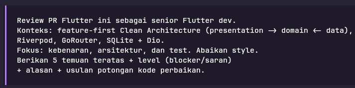
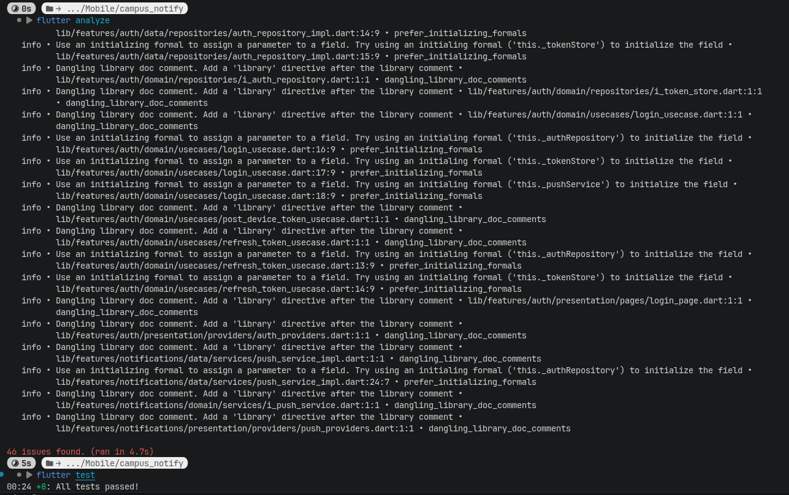

# Week 8

## Tujuan

- Menjelaskan Git Flow dan strategi branching (main, develop, feature/*, fix/*)
- Menulis commit dan Pull Request yang berkualitas dan mudah direview
- Melakukan peer code review yang konstruktif dengan checklist terstruktur
- Menjalankan static analysis dan formatter (flutter analyze, dart format) hingga bersih
- Menilai kesiapan project tengah semester dan menindaklanjuti hasil review
- Memverifikasi saran review dari AI sebelum diterapkan

## Fitur Utama

- Tidak ada aplikasi yang dibangun, hanya melihat Git

## Hasil yang Dicapai

### Hygiene Branch dan Commit 

Tabel pesan commit yang buruk di repository ini dan perbaikannya

| Sebelum | Perbaikan |
| :---: | :---: |
| feat: tambah testing | feat: tambah file test kevalidan autentikasi | 
| add README for week 6 | docs: add README for week 6 |
| answer reflection week 5 | docs: answer reflection week 5 |

### Branch Kerja

main      -> selalu rilis, dilindungi
develop   -> integrasi fitur mingguan
feature/* -> kerja harian, pendek
fix/*     -> perbaikan cepat + test

### Pull Request dan Peer Review

Contoh PR:
```
Judul: feat(notes): validasi judul kosong + test
Masalah: pengguna bisa menyimpan catatan tanpa judul.
Solusi: validasi di use case + pesan error di UI.
Cara uji:
1) tambah catatan kosong -> error muncul.
2) flutter test test/validate_note_test.dart
```

Contoh Review:
```
Fungsi build 60 baris + 3 tanggung jawab.
Usul: pecah validasi ke core/validate.dart.
Alasan: bisa diunit-test tanpa widget.
```

## AI Challenge



Hasil:

Verifikasi: flutter analyze = 0 error/warning (46 info, semua style), flutter test = 8/8 hijau. Justru karena semuanya hijau, temuan di bawah ini belum tertangkap.

### 1. Blocker — GoRouter dibangun ulang setiap perubahan auth; refreshListenable mati

`lib/main.dart:21-51 (khususnya baris 22 dan 26)`

```
final authState = ref.watch(authStateProvider);           // line 22
return GoRouter(
  refreshListenable: ValueNotifier(authState),            // line 26 ← tidak pernah di-notify
```

ValueNotifier dibuat baru dengan nilai awal dan tidak pernah di-update, jadi mekanisme refresh tidak berfungsi sama sekali. Perpindahan redirect "berhasil" hanya karena `ref.watch` memicu provider rebuild → GoRouter baru tiap transisi auth. Akibatnya: stack navigasi di-reset, GoRouter lama tidak pernah di-dispose (tidak ada `ref.onDispose` → leak), dan saat startup dengan token valid build pertama masih `AsyncLoading (authState.value ?? false == false)` → di-redirect ke `/login` dulu (flash halaman login yang kredensial demo-nya sudah ter-prefill), baru router dibangun ulang ke `/`. Diselesaikan dengan listenable stabil + penanganan state loading:

```
class _RouterRefreshNotifier extends ChangeNotifier {
  _RouterRefreshNotifier(Ref ref) {
    ref.listen<AsyncValue<bool>>(authStateProvider, (_, next) {
      if (!next.isLoading) notifyListeners();
    });
  }
}

final routerProvider = Provider<GoRouter>((ref) {
  final refresh = _RouterRefreshNotifier(ref);
  ref.onDispose(refresh.dispose);           // jangan bocorkan GoRouter

  return GoRouter(
    initialLocation: AppRoutes.home,
    refreshListenable: refresh,
    redirect: (context, state) {
      final auth = ref.read(authStateProvider);
      if (auth.isLoading) return null;      // jangan tendang ke /login saat cek token
      final loggedIn = auth.value ?? false;
      final goingLogin = state.matchedLocation == AppRoutes.login;
      if (!loggedIn && !goingLogin) return AppRoutes.login;
      if (loggedIn && goingLogin) return AppRoutes.home;
      return null;
    },
    routes: [ /* tidak berubah */ ],
  );
});
```

### 2. Blocker — Interceptor 401: refresh tanpa single-flight + retry tak terbatas

`lib/features/auth/data/datasources/api_client.dart:33-67 `(wiring: `auth_providers.dart:27-37`)

Poin bagus: refresh sudah pakai `refreshAuthRepo` tanpa interceptor, jadi loop lewat `/refresh` sendiri aman. Tapi dua masalah tersisa:

1. N request paralel yang kena 401 → N panggilan `/refresh`. Kalau backend memakai refresh-token rotation (umum), refresh pertama meng-invalidate token lama → sisanya gagal → `tokenStore.clear()` (baris 44) → user ter-logout paksa.
1. Retry tidak dibatasi (baris 57-60). Hasil `dio.fetch(...)` melewati interceptor lagi; jika server tetap membalas 401 (misal endpoint butuh role lain), terjadi siklus refresh → retry → 401 tanpa henti.

```
Future<String?>? refreshInFlight;   // state bersama untuk semua request

dio.interceptors.add(InterceptorsWrapper(
  onError: (e, handler) async {
    final req = e.requestOptions;
    if (e.response?.statusCode != 401 || req.extra['_retried'] == true) {
      return handler.next(e);       // sudah pernah di-retry → jangan ulangi
    }
    final read = await tokenStore.readRefreshToken();
    if (read.token == null) return handler.next(e);

    Future<String?> refresh() async {
      try {
        final res = await refreshAuthRepo.refreshToken(read.token!);
        if (res.failure != null || res.accessToken == null) {
          await tokenStore.clear();
          return null;
        }
        await tokenStore.save(
          accessToken: res.accessToken!,
          refreshToken: read.token!,
        );
        return res.accessToken;
      } finally {
        refreshInFlight = null;
      }
    }

    // single-flight: 401 bersamaan hanya memicu SATU refresh
    final newAccess = await (refreshInFlight ??= refresh());
    if (newAccess == null) return handler.next(e);

    req.extra['_retried'] = true;
    req.headers['Authorization'] = 'Bearer $newAccess';
    return handler.resolve(await dio.fetch(req));
  },
));
```

### 3. Blocker — postDeviceToken menelan Failure dan selalu melaporkan sukses; jalur pemanggilan ganda

`lib/features/notifications/data/services/push_service_impl.dart:184-203, lib/features/auth/domain/usecases/login_usecase.dart:49-58`

```
try {
  await _authRepository.postDeviceToken(token);   // hasil record dibuang!
  return (success: true, failure: null);          // ← selalu sukses
} catch (e) { ... }
```

`_mapDioError` di repository mengembalikan Failure sebagai nilai, bukan throw — jadi implementasi ini melaporkan `success: true` walau backend tidak pernah menerima token. Di LoginUseCase, try/catch (baris 50-58) tidak akan pernah menangkap apa pun karena impl-nya juga tidak throw → kegagalan device token benar-benar senyap. Ini juga jalur ganda: `main.dart:81` dan `announcement_list_page.dart:34` memakai PostDeviceTokenUseCase, sementara login memakai IPushService.postDeviceToken — padahal use case-nya sudah ada.

```
// push_service_impl.dart — teruskan hasil apa adanya
@override
Future<({bool success, Failure? failure})> postDeviceToken(String token) async {
  final repo = _authRepository;
  if (repo == null) {
    return (success: false, failure: const LocalFailure('AuthRepository tidak tersedia'));
  }
  return repo.postDeviceToken(token);
}
// login_usecase.dart — inject PostDeviceTokenUseCase, hapus method dari IPushService
final fcmToken = await _pushService.getToken();
if (fcmToken != null) {
  final result = await _postDeviceTokenUseCase(fcmToken);
  if (result.failure != null) { /* log saja; login tetap sukses */ }
}
```

Terkait: logout hanya membersihkan token lokal (`auth_providers.dart:110-117`). IAuthRepository.logout (`auth_repository_impl.dart:136`) dan unsubscribeFromCampusTopic tidak pernah dipanggil siapa pun — device token tetap terdaftar di backend dan perangkat tetap ter-subscribe topic setelah logout. Sebaiknya ada LogoutUseCase yang: deregister device token → unsubscribe topic → clear storage.

### 4. Blocker — Test tidak menyentuh satu pun jalur kritis (auth/refresh/error-mapping)

`test/announcements_usecases_test.dart, test/push_service_test.dart`

8 test hijau, tapi: 4 test hanya memverifikasi use case pass-through mendelegasikan ke mock repo (GetAnnouncementsUseCase isinya cuma `return _repository.fetch...()`), 4 test lagi routeFromMessage. Nol coverage untuk kode yang benar-benar berlogika: LoginUseCase (kontrak "save token gagal ⇒ login jangan dianggap sukses"), RefreshTokenUseCase (kontrak "refresh gagal ⇒ clear token"), AuthNotifier, _mapDioError (disalin duplikat di dua repo), parsing DTO, dan interceptor. Bug #2 dan #3 di atas persis tipe bug yang lolos karena jalur ini tidak diuji. Contoh test yang paling bernilai untuk PR ini:

```
// test/refresh_token_usecase_test.dart
test('refresh gagal → token lokal dibersihkan & failure diteruskan', () async {
  when(() => tokenStore.readRefreshToken())
      .thenAnswer((_) async => (token: 'refresh-1', failure: null));
  when(() => authRepository.refreshToken('refresh-1')).thenAnswer(
    (_) async => (accessToken: null, failure: const AuthFailure('refresh expired')),
  );
  when(() => tokenStore.clear()).thenAnswer((_) async => null);

  final result = await RefreshTokenUseCase(
    authRepository: authRepository,
    tokenStore: tokenStore,
  )();

  expect(result.accessToken, isNull);
  expect(result.failure, isA<AuthFailure>());
  verify(() => tokenStore.clear()).called(1);   // kontrak penting
});
```

### 5. Saran — Cache pengumuman tidak pernah di-invalidasi saat sesi berubah; pull-to-refresh tidak menunggu fetch

`lib/features/announcements/presentation/providers/announcements_providers.dart:38-46, announcement_list_page.dart:113-114`

Komentar "Auto-refetches on auth state change (via apiClientProvider dependency)" itu keliru: apiClientProvider hanya bergantung pada tokenStoreProvider yang instansnya tidak pernah berubah, dan announcementsProvider bukan autoDispose → setelah logout/login berikutnya, list tetap menyajikan AsyncData lama tanpa fetch ulang. Lalu ref.invalidate mengembalikan void, sehingga `onRefresh: () async => ref.invalidate(...)` selesai seketika — spinner pull-to-refresh hilang sebelum jaringan selesai.

```
final announcementsProvider = FutureProvider<List<Announcement>>((ref) async {
  ref.watch(authStateProvider);   // sesi berubah → cache dibuang, fetch ulang
  final result = await ref.watch(getAnnouncementsUseCaseProvider)();
  if (result.failure != null) throw failureToException(result.failure!);
  return result.announcements;
});
RefreshIndicator(
  onRefresh: () => ref.refresh(announcementsProvider.future), // tunggu refetch selesai
  child: ListView.separated(...),
)
```

### Catatan lain (di luar 5 besar)
- pushInitProvider (`push_providers.dart:33`) selalu throw UnimplementedError — dead code yang pasti crash kalau dipakai; hapus.
- Base URL https://example-campus-api.test di-hardcode di dua tempat (`api_client.dart:14`, `auth_providers.dart:30`) — placeholder .test; sebelum rilis pakai String.fromEnvironment('API_BASE_URL') + --dart-define.
- `_mapDioError` disalin hampir identik di auth_repository_impl.dart:21 dan announcement_repository_impl.dart:15 → ekstrak ke `core/` agar klasifikasi status konsisten.
- announcementDetailProvider (`announcements_providers.dart:55`) memakai `result.announcement!` — crash jika repo mengembalikan (`announcement: null, failure: null`); guard dulu dan lempar NotFoundFailure.
- Route dari payload FCM langsung di-`router.push` tanpa validasi (`main.dart:70`) — server-controlled deep link; minimal whitelist prefix /pengumuman/.

Kesimpulan: struktur layer dan wiring provider sudah rapi (presentation tidak menyentuh Dio/Firebase, DTO terisolasi, Failure hierarchy konsisten — sesuai target REFACTOR_PLAN.md). Tapi saya sarankan jangan merge dulu: #1–#3 adalah bug kebenaran di jalur auth/push (senyap, sulit dideteksi manual), dan #4 berarti tidak ada jaring pengaman di jalur-jalur tersebut. #5 aman menyusul.

---

### Apakah temuan benar-benar ada? Buktikan dengan grep, test gagal, atau reproduksi manual.

Semua referensinya nyata, seperti di #1:

`lib/main.dart:21-51 (khususnya baris 22 dan 26)`

```
final authState = ref.watch(authStateProvider);           // line 22
return GoRouter(
  refreshListenable: ValueNotifier(authState),            // line 26 ← tidak pernah di-notify
```

### Apakah usulan melanggar dependency rule (domain mengimpor Flutter/Dio/SQLite)? Tolak bila ya.

Tidak ada usulan yang melanggar dependency rule

### Apakah AI hanya nitpick style yang seharusnya ditangani formatter/CI?

Tidak, sudah dari awal kalau AI mengakuinya (46 info, semua style)

### Minimal 2 temuan AI terbukti benar dengan bukti, dan minimal 1 temuan ditolak dengan alasan tertulis.

Tidak ada temuan yang ditolak karena terbukti semua
- Klaim #2 tentang retry (401) tak terbatas bisa dilakukan, hanya berhenti karena input benar (200)
- Setelah logout, token memang sama. Hanya berubah jika data dihapus

### Keputusan final dan alasan teknis Anda, boleh berbeda dari saran AI selama berargumen.

Setuju dengan AI karena memang terbukti dengan test case yang dibuat

## Testing


