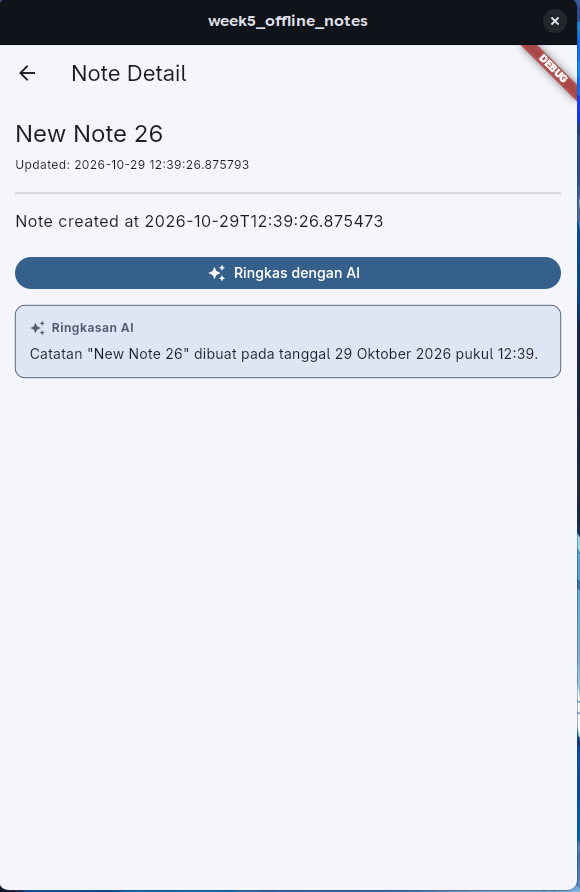
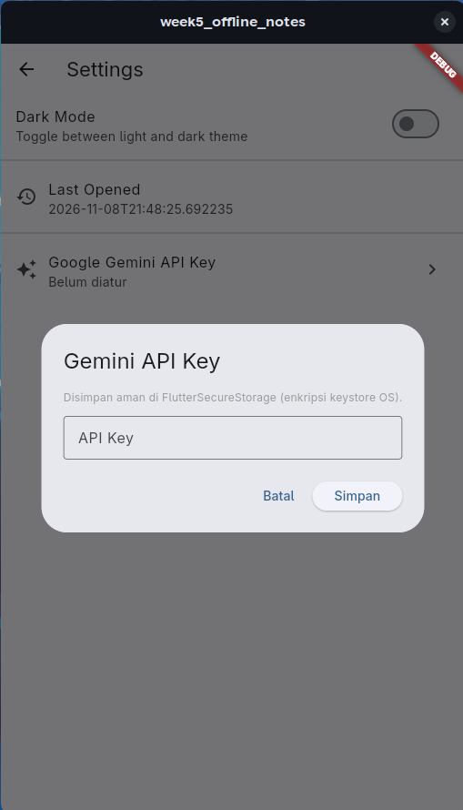
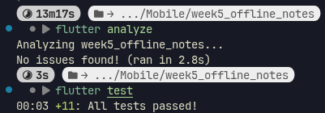

# Week 10

## Tujuan

- Memahami konsep integrasi LLM API ke aplikasi mobile
- Merancang chat interface dengan streaming response
- Mengintegrasikan OCR, Speech-to-Text, dan Image Understanding
- Menerapkan prompt design yang aman dan efektif
- Menangani privasi, biaya, error handling, dan fallback design
- Mengevaluasi pengalaman pengguna pada fitur AI

## Fitur Utama

- Aplikasi notes dengan fitur AI Summarizer menggunakan Google Gemini API via Dynamic Model Discovery (mendukung `gemini-1.5-flash-latest`, `gemini-2.0-flash`, dan `gemini-pro` dengan pembersihan output non-thinking)
- Penyimpanan kunci aman dengan `flutter_secure_storage` 

## Hasil yang Dicapai

### Integrasi Fitur AI

Aplikasi mengirim judul & isi catatan ke Google Gemini API, lalu mengirim ringkasannya



### Prompt Engineering & Sanitasi Output

Struktur 5 Slot Prompt: Menjelaskan perancangan prompt (Peran, Konteks, Tugas, Batasan, dan Output)

### Keamanan Kunci & Privasi Pengguna

Penyimpanan API aman dengan `flutter_secure_storage`, input user sendiri. Aplikasi juga hanya mengirim teks catatan yang ditekan oleh pengguna



## Tugas: Prompt

### 1. Spesifikasi Fitur
- **Nama Fitur**: AI Note Summarizer (Perangkum Catatan Pintar)
- **Model / Provider**: Google Gemini API via Dynamic Model Discovery (`gemini-1.5-flash-latest`, `gemini-2.0-flash`, `gemini-pro`)
- **Tujuan**: Meringkas isi catatan panjang secara otomatis menjadi ringkasan padat 2-3 poin utama tanpa mengharuskan pengguna membaca seluruh dokumen.
- **Penyimpanan Kunci**: `flutter_secure_storage` (dienkripsi pada Keystore Android / Keychain iOS).

---

### 2. Struktur Prompt Design

Prompt dirancang dengan 5 komponen utama:

| Komponen | Implementasi pada Aplikasi |
|---|---|
| **Peran (Persona)** | *"Kamu adalah asisten perangkum catatan ringkas."* |
| **Konteks** | Judul catatan dan isi teks catatan pengguna. |
| **Tugas** | *"Buat ringkasan padat dan poin utama dari catatan berikut dalam Bahasa Indonesia yang jelas."* |
| **Batasan** | *"Maksimal 3-4 kalimat atau poin ringkas. Jangan sertakan asumsi atau halusinasi di luar teks catatan."* |
| **Format Output** | Teks terformat ringkas, langsung pada poin inti. |

#### Template Prompt Lengkap
```text
Kamu adalah asisten perangkum catatan ringkas.
Tugas: Buat ringkasan padat dan poin utama dari catatan berikut dalam Bahasa Indonesia yang jelas.
Batasan: Maksimal 3-4 kalimat atau poin ringkas. Jangan sertakan asumsi di luar teks catatan.

Judul: {title}
Isi: {body}
```

---

### 3. Sampel Input & Output Awal AI

#### Input (Catatan Perkuliahan Mobile)
```text
Judul: Ringkasan Kuliah Pemrograman Mobile Minggu 10
Isi:
Hari ini dosen menjelaskan tentang integrasi Large Language Model ke aplikasi Flutter. Arsitektur yang dipakai harus memisahkan presentasi, domain, dan data. API Key tidak boleh ditaruh secara hardcode di kode sumber karena rawan terekspos di repository publik. Kita menggunakan flutter_secure_storage untuk mengenkripsi API key. Jika internet mati atau kuota API habis, aplikasi harus tetap berjalan dalam mode offline tanpa crash.
```

#### Output Awal AI
```text
- Perkuliahan membahas integrasi model LLM ke aplikasi Flutter menggunakan arsitektur bersih (presentation, domain, data).
- Kunci API wajib disimpan secara aman menggunakan flutter_secure_storage dan tidak boleh di-hardcode.
- Sistem harus memiliki fallback mode offline agar aplikasi tetap stabil saat koneksi internet terputus atau kuota API habis.
```

---

### 4. Analisis Privasi & Keamanan Data
- **Keamanan Kunci**: Pengguna memasukkan API key mereka sendiri melalui halaman Pengaturan, disimpan langsung di penyimpanan aman terenkripsi (`FlutterSecureStorage`).
- **Privasi Pengguna**: Aplikasi tidak mengirimkan pengenal pribadi (nama pengguna, ID perangkat, NIK, dsb.) ke AI endpoint. Hanya judul dan isi spesifik catatan yang dikirim atas permintaan eksplisit pengguna (user-initiated trigger).

---

### 5. Strategi Error Handling & Fallback Design
1. **Validasi Lokal**: Jika isi catatan kosong, request dibatalkan di level klien tanpa membuang kuota API.
2. **Ketiadaan API Key**: Menampilkan pesan informatif ramah pengguna yang mengarahkan ke halaman pengaturan.
3. **Penanganan Masalah Jaringan / Kuota**: Menangkap HTTP 400/403/Timeout menggunakan `DioException` dan menampilkan peringatan tanpa memblokir fungsi baca/tulis catatan lokal (SQLite tetap berfungsi normal).

## Tabel Risiko dan Mitigasi (Privasi & Biaya)

| Risiko | Dampak | Mitigasi yang Diterapkan |
|---|---|---|
| Bocor API Key | Kunci disalahgunakan pihak ketiga | Kunci tidak di-hardcode ke kode sumber, melainkan diinput user di halaman Settings dan disimpan via `flutter_secure_storage` |
| Bocor Data Pengguna ke AI | Privasi user terancam | Hanya mengirim judul dan isi catatan yang dipilih user. Tidak mengirim informasi pribadi |
| Biaya dan Kuota Membengkak | Tagihan API melonjak | Validasi catatan kosong dilakukan di lokal tanpa memanggil API. Panggilan hanya dieksekusi secara manual via interaksi user |
| Layanan AI Error / Offline | Aplikasi macet | Dio exception ditangkap dengan pesan ramah. Catatan tetap tersimpan dan dapat dibaca secara lokal via SQLite |

## Bukti Mesin Hijau (Quality Assurance)


