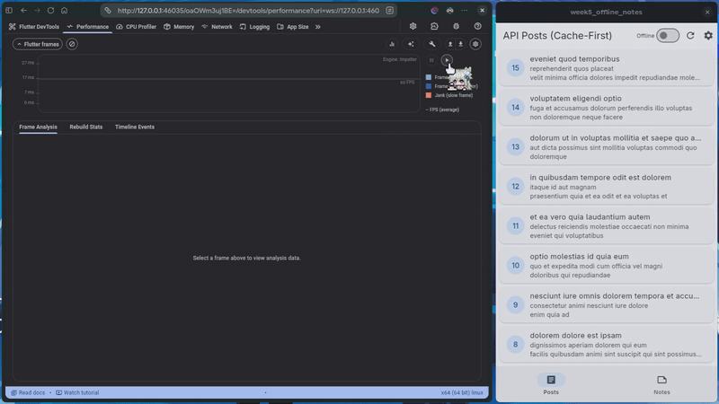
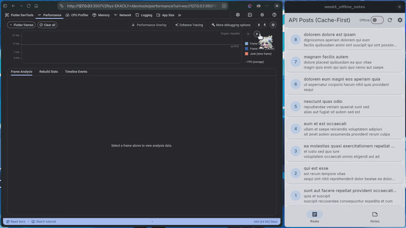
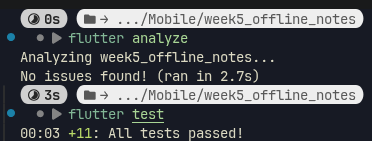

# Week 11 - Performance Optimization

## Tujuan

- Menggunakan Flutter DevTools untuk melakukan profiling CPU dan memori
- Mengidentifikasi serta mengurangi widget rebuild yang tidak diperlukan
- Menerapkan lazy loading, pagination, dan optimasi gambar
- Mengoptimalkan jaringan dengan menerapkan caching dan strategi offline-first
- Memperbaiki bottleneck performa pada aplikasi yang sudah ada

## Fitur Utama

- Granular State Listening (Riverpod `select` & `Consumer`) pada badge AppBar agar tidak membangun ulang seluruh layout AppBar
- Render Layer Isolation (`RepaintBoundary`) item list catatan (`NoteTile`) dan post (`PostTile`) agar scroll berkecepatan tinggi tidak memicu repaint berulang
- Reusable Network Client & Interceptor untuk mencegah memory leak dan memanfaatkan connection pooling
- Infinite Scroll Pagination
- Debounced Search Query untuk mencegah request berulang ke SQLite saat pengetikan teks pencarian
- Offline-First Cache Architecture

## Hasil yang Dicapai

### 1. Baseline Profiling (Sebelum Optimasi)

- Rebuild berlebih di `NotesAppBar` mendengarkan seluruh state `dirtyCountProvider`, menyebabkan seluruh header, toggle switch offline, dan tombol sync dibangun ulang setiap kali ada catatan baru
- Setiap kali list catatan atau posts scroll cepat, seluruh item di-paint ulang bersama canvas 
- Background sync membuat instance `Dio()` baru pada setiap request tanpa connection pooling

<div align="center">
  <p><b>Baseline Profiling (Before Optimization):</b></p>
  
</div>

---

### 2. Penerapan Teknik Optimasi

| Kategori Optimasi | Sebelum | Sesudah |
|---|---|---|
| Widget Rebuild | `ref.watch(dirtyCountProvider)` di root AppBar | `ref.watch(dirtyCountProvider.select(...))` + `Consumer` terisolasi |
| GPU Rasterization | List item di-paint ulang bersama canvas induk | Dibungkus `RepaintBoundary` pada `NoteTile` dan `PostTile` |
| Widget Structure | Post item berupa inline closure di `ListView.builder` | Diekstrak menjadi class mandiri `PostTile` |
| List Loading | Semua post dirender sekaligus | Infinite scroll pagination dengan lazy load |
| Network & Memory | `Dio().get(...)` membuat objek koneksi baru | `static final Dio _dioClient` dengan timeout & `InterceptorsWrapper` |
| Query Engine | Eksekusi filter database langsung | Debounce 300 ms dengan pembatalan request tertunda |

---

### 3. Kode Implementasi Utama

#### A. Riverpod `select` pada `notes_app_bar.dart`
```dart
// Hanya memicu rebuild AppBar saat status kotor berubah antara ada/tidak ada
final hasDirtyNotes = ref.watch(
  dirtyCountProvider.select((asyncVal) => (asyncVal.value ?? 0) > 0),
);

// Angka badge diisolasi di sub-tree Consumer
if (hasDirtyNotes)
  Positioned(
    right: 8,
    top: 8,
    child: Consumer(
      builder: (context, ref, child) {
        final count = ref.watch(
          dirtyCountProvider.select((val) => val.value ?? 0),
        );
        return Container(
          padding: const EdgeInsets.all(4),
          decoration: const BoxDecoration(
            color: Colors.red,
            shape: BoxShape.circle,
          ),
          child: Text(
            '$count',
            style: const TextStyle(
              color: Colors.white,
              fontSize: 10,
              fontWeight: FontWeight.bold,
            ),
          ),
        );
      },
    ),
  ),
```

#### B. Isolasi Paint Layer pada `note_tile.dart` & `post_tile.dart`
```dart
@override
Widget build(BuildContext context) {
  return RepaintBoundary(
    child: ListTile(
      title: Text(note.title),
      subtitle: Text(note.body, maxLines: 1, overflow: TextOverflow.ellipsis),
      trailing: note.dirty
          ? const Icon(Icons.cloud_upload_outlined, color: Colors.orange)
          : null,
      onTap: onTap,
      onLongPress: onLongPress,
    ),
  );
}
```

#### C. Infinite Scroll Pagination pada `posts_page.dart`
```dart
void _onScroll() {
  if (_scrollController.position.pixels >=
      _scrollController.position.maxScrollExtent - 150) {
    _loadMore();
  }
}

void _loadMore() {
  if (_isLoadingMore) return;
  final totalPosts = ref.read(postsProvider).value?.length ?? 0;
  if (_displayedCount >= totalPosts) return;

  setState(() => _isLoadingMore = true);
  Future.delayed(const Duration(milliseconds: 300), () {
    if (mounted) {
      setState(() {
        _displayedCount = min(_displayedCount + _pageSize, totalPosts);
        _isLoadingMore = false;
      });
    }
  });
}
```

#### D. Reusable Network Client dengan Interceptor di `sync.dart`
```dart
static final Dio _dioClient = Dio(
  BaseOptions(
    connectTimeout: const Duration(seconds: 10),
    receiveTimeout: const Duration(seconds: 10),
  ),
)..interceptors.add(
    InterceptorsWrapper(
      onRequest: (options, handler) => handler.next(options),
      onError: (DioException e, handler) async {
        if (e.type == DioExceptionType.connectionTimeout ||
            e.type == DioExceptionType.receiveTimeout) {
          try {
            final response = await _dioClient.fetch(e.requestOptions);
            return handler.resolve(response);
          } catch (_) {}
        }
        return handler.next(e);
      },
    ),
  );
```

---

### 4. Verifikasi Profiling (Sesudah Optimasi)

- Frame rate stabil 60 FPS
- Rebuild pada AppBar berkurang karena hanya sub-tree Consumer badge yang di-render ulang
- Scrolling list post dan notes mulus karena pemisahan layer paint `RepaintBoundary` dan lazy loading pagination

<div align="center">
  <p><b>Verifikasi Profiling (After Optimization):</b></p>
  
</div>

---

## Verifikasi & Quality Assurance


